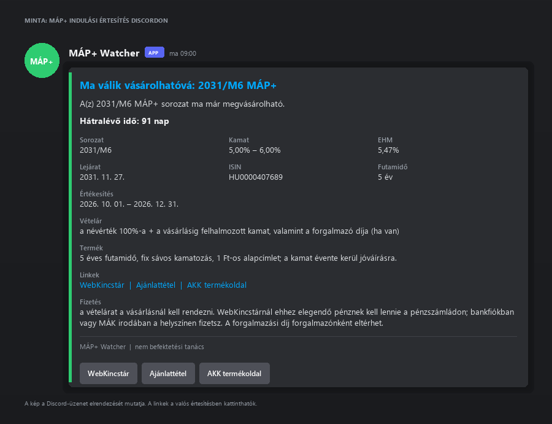

# MÁP+ Watcher


> **English:** Watches new Hungarian MÁP+ government bond series and sends
> Discord/Telegram alerts when they are announced and when they become
> available for purchase. Runs twice a day on GitHub Actions.

Magyar állampapír-figyelő, kifejezetten a **MÁP+ (Magyar Állampapír Plusz)**
sorozatokra. Nem híreket gyűjt, nem híroldalakat scrape-el: kizárólag az ÁKK
hivatalos nyilvános ajánlattételeit és lakossági kamatadatait dolgozza fel.

A cél, hogy időben tudd:

- **mikor jelenik meg** egy új MÁP+ sorozat,
- **mikor és meddig vásárolható**,
- **mennyiért** vehető meg (kamat, EHM, vételár),
- **mit tud** a termék (futamidő, kamatozás, címlet, kamatfizetés),
- melyik hivatalos dokumentumban vannak a részletek.

Az értesítések **Discordra és Telegramra** mennek. A figyelő GitHub Actions
alatt fut, ingyenes nyilvános repóban, naponta kétszer.



*Minta: a Discord-üzenet elrendezése. A linkek a valós értesítésben kattinthatók.*

---

## Mit tartalmaz az értesítés?

Példa egy indulási értesítésre:

```text
Ma válik vásárolhatóvá: 2031/M6 MÁP+

A(z) 2031/M6 MÁP+ sorozat ma már megvásárolható.

  Sorozat: 2031/M6
  ISIN: HU0000407689
  Értékesítés: 2026. 10. 01. – 2026. 12. 31.
  Lejárat: 2031. 11. 27.
  Kamat: 5,00% – 6,00%
  EHM: 5,47%
  Termék: 5 éves futamidő, fix sávos kamatozás, 1 Ft-os alapcímlet;
          a kamat évente kerül jóváírásra.
  Vételár: a névérték 100%-a + a vásárlásig felhalmozott kamat,
           valamint a forgalmazó díja (ha van).

Fizetés: a vételárat a vásárlásnál kell rendezni. WebKincstárnál ehhez
elegendő pénznek kell lennie a pénzszámládon; bankfiókban vagy MÁK irodában
a helyszínen fizetsz. A forgalmazási díj forgalmazónként eltérhet.

Vásárlás:
  WebKincstár: https://webkincstar.allamkincstar.gov.hu/
  Magyar Államkincstár irodái
  Lakossági forgalmazók (bankok)

További információ:
  Nyilvános ajánlattétel (PDF): https://documents.akk.hu/...
  MÁP+ termékoldal: https://www.akk.hu/...
```

A kihirdetéskori értesítésben ezen felül a **kihirdetés időpontja** is
szerepel, hogy lásd, mikor jelent meg a sorozat.

Discordon ugyanez **mezőkre bontott kártyaként** jelenik meg, a fontos
adatokkal és kattintható gombokkal. A Telegram-üzenetben a címkék
félkövérek, alatta szintén gombok vannak.

---

## Hogyan működik?

Két független ÁKK-adatforrást használ:

1. **Nyilvános ajánlattételek** (`getPublicOfferings`, `MAPP_T`):
   itt jelenik meg először az új sorozat, jellemzően néhány nappal a
   vásárlási időszak kezdete előtt. Innen jön a név, ISIN, kezdő- és
   zárónap, lejárat, kamatsáv, valamint a PDF-link.
2. **Aktuális lakossági kamatok** (`getRetailInterestExt`, `MÁP Plusz`):
   innen jön a pontosabb kamat/EHM adat, és ez a tartalék forrás, ha az
   ajánlattételi lista átmenetileg késik.

A program **nem feltételezi**, hogy minden hónapban ugyanaznap indul egy
sorozat. Az ÁKK által közzétett tényleges `startPeriod` dátumot használja,
így a változó ütemezésnél is jó.

Kétfázisú értesítés:

- **Kihirdetés:** az ÁKK megjelenteti a következő sorozatot.
- **Indulás:** elérkezik a vásárlási időszak kezdete.

Az ismételt értesítéseket a `state.json` állapotfájl akadályozza meg.
GitHub Actions alatt ez az állapot az **Actions cache-ben** tárolódik,
nem commitolódik a repóba.

> Az ÁKK adatforrása nem dokumentált, nyilvános API. Ha az ÁKK változtat
> rajta, a program hibát jelez a naplóban; ilyenkor a forráskódban a
> végpontot kell frissíteni. Egy ellenőrzés két kisméretű kérést jelent.

---

## GitHub Actions beállítása

A repó: [Gyuri125/map-plusz-watcher](https://github.com/Gyuri125/map-plusz-watcher).
A figyelő GitHub Actions alatt fut; a nyilvános repóban a standard runner
ingyenes. Ha forkoltad a repót, a secretöket a saját forkodban állítsd be.

### 1. Secretök beállítása

A GitHubon: **Settings > Secrets and variables > Actions > New repository
secret**.

A `.gitignore` miatt a `config.toml`, `.env`, `state.json` és `logs/` nem
kerül a repóba. A `config.ci.toml` viszont igen, mert abban csak `${...}`
helyőrzők vannak, valódi titkok nincsenek.

| Secret | Kötelező? | Mit tartalmaz? |
|---|---|---|
| `DISCORD_WEBHOOK_URL` | igen, ha a Discord be van kapcsolva | A Discord csatorna webhook URL-je. |
| `TELEGRAM_BOT_TOKEN` | igen, ha a Telegram be van kapcsolva | A @BotFather által adott bot token. |
| `TELEGRAM_CHAT_ID` | igen, ha a Telegram be van kapcsolva | A cél chat/csatorna azonosítója. |

A `config.ci.toml` alapértelmezésben **mindkét** csatornát bekapcsolja.
Ha csak az egyiket használod, a másikat állítsd `enabled = false` értékre,
és a hozzá tartozó secretet nem kell beállítanod.

### 2. Első futtatás

A GitHubon: **Actions > MÁP+ ellenőrzés > Run workflow**.

Az első futás egy összefoglalót küld a jelenleg kapható és a hamarosan
induló sorozatokról. Ezután már csak akkor küld, ha új sorozat jelenik meg,
vagy egy sorozat vásárolhatóvá válik.

### 3. Ütemezés

A workflow a `.github/workflows/map-plusz-check.yml` fájlban van. A
beállított ütemezés UTC szerint:

- **06:00 UTC** = 07:00/08:00 Magyarországon (nyári/téli időszámtól függően)
- **15:00 UTC** = 16:00/17:00 Magyarországon

A délutáni futás elkapja az ÁKK aznapi kihirdetéseit, a reggeli pedig az
indulás napján időben szól. A GitHub Actions ütemezett futásai néhány
percet késhetnek nagy terhelés esetén.

### 4. Állapot és cache

A workflow a `state.json`-t az Actions cache-ből állítja vissza, majd a
futás végén új cache-be menti. Ez biztosítja, hogy ne küldjön ugyanarról
a sorozatról minden futáskor újra értesítést.

- A cache nem része a repónak, így nem szennyezi a commitokat.
- Ha a cache 7 nap inaktivitás miatt törlődik, a következő futás újra
  „első futásnak” számít, és összefoglalót küld. Ez nem hiba.
- A GitHub Actions cache a default branch-hez tartozik; a scheduled
  workflow is ott fut.

A futás végén a GitHub Actions **Step Summary** is megjelenik a run oldalán:
jelenleg kapható és hamarosan induló sorozatok, valamint az értesítések
összefoglalója.

### 5. Tesztek

A repóban külön workflow futtatja a unit teszteket push és pull request
esetén:

```text
.github/workflows/tests.yml
```

Ez nem küld értesítést, nem kellenek hozzá secretök.

---

## Discord webhook beállítása

1. A Discord szerveren nyisd meg a kívánt csatorna beállításait:
   **Csatorna szerkesztése > Integrációk > Webhookok > Új webhook**.
2. Adj neki nevet (pl. `MÁP+ értesítő`), válaszd ki a csatornát, és
   másold ki a **Webhook URL**-t.
3. GitHubon add hozzá `DISCORD_WEBHOOK_URL` néven secretként.
4. Helyi teszthez a `.env` fájlba:

```dotenv
DISCORD_WEBHOOK_URL=https://discord.com/api/webhooks/...
```

A webhook URL **titok**, mert aki ismeri, tud üzenetet küldeni a
csatornára. Ne commitold, ne oszd meg, és ha véletlenül kikerül, töröld
a webhookot a Discordban, majd készíts újat.

A program Discord **embed** formában küldi az értesítést: cím, rövid
leírás, mezők (sorozat, kamat, EHM, vételár, termék), lábléc, valamint
WebKincstár, ajánlattétel és termékoldal gombok. A PDF-link az embed
címére és a gombok közé is kerül.

---

## Telegram bot beállítása

1. Telegramban nyisd meg a **@BotFather** botot.
2. `/newbot`, adj neki nevet és felhasználónevet.
3. Jegyezd fel a kapott **bot tokent**.
4. A saját `chat_id`-det a **@userinfobot** bot megmondja. Csoportos
   használatnál add hozzá a botot a csoporthoz, és a csoport chat_id-jét
   használd (általában negatív szám).
5. GitHubon add hozzá a `TELEGRAM_BOT_TOKEN` és `TELEGRAM_CHAT_ID`
   secretöket.
6. Helyi teszthez a `.env` fájlba:

```dotenv
TELEGRAM_BOT_TOKEN=123456:ABC...
TELEGRAM_CHAT_ID=123456789
```

A botnak legalább egyszer írj rá (`/start`), különben nem tud neked
üzenetet küldeni. Az üzenetben a fontos címkék félkövérek, alatta
WebKincstár, ajánlattétel és termékoldal gombok jelennek meg.

---

## Helyi használat

A GitHub Actions mellett helyben is kipróbálhatod. Klónozd a repót:

```powershell
git clone https://github.com/Gyuri125/map-plusz-watcher.git
cd map-plusz-watcher
```

### 1. Python

Python **3.11 vagy újabb** kell. Ellenőrzés:

```powershell
python --version
```

### 2. Config létrehozása

```powershell
python -m allampapir_ertesito init
```

Ez létrehozza a `config.toml`-t a `config.example.toml` mintából. A
`config.toml` a `.gitignore` miatt nem kerül a repóba.

### 3. Titkok `.env` fájlban

```powershell
copy .env.example .env
```

Töltsd ki a `.env`-t. A program a config mellett lévő `.env`-t
automatikusan betölti; a már beállított környezeti változókat nem írja
felül.

### 4. Csatorna bekapcsolása

A `config.toml`-ban kapcsold be a Discordot és/vagy a Telegramot:

```toml
[notifiers.discord]
enabled = true
webhook_url = "${DISCORD_WEBHOOK_URL}"

[notifiers.telegram]
enabled = true
bot_token = "${TELEGRAM_BOT_TOKEN}"
chat_id = "${TELEGRAM_CHAT_ID}"
```

### 5. Teszt és próba

```powershell
python -m allampapir_ertesito test
python -m allampapir_ertesito check --dry-run
python -m allampapir_ertesito check
```

A `--dry-run` nem küld értesítést és nem módosítja az állapotot, csak
kiírja, mi menne ki.

### 6. Opcionális: helyi ütemezés

Ha nem GitHub Actions alatt szeretnéd futtatni, hanem a saját gépeden:

```powershell
powershell -ExecutionPolicy Bypass -File scripts\register_task.ps1 -Time "09:00","15:00"
```

A részletek a szkript fejlécében és a `scripts/` mappában vannak.

---

## Beállítások

A teljes, kommentelt minta a [`config.example.toml`](config.example.toml).
A GitHub Actions a [`config.ci.toml`](config.ci.toml) fájlt használja.

Fontosabb `[app]` kulcsok:

| Kulcs | Alapértelmezés | Jelentés |
|---|---|---|
| `first_run_notify` | `true` | Első futáskor küldjön-e összefoglalót. |
| `announce_new_offerings` | `true` | Küldjön-e értesítést kihirdetéskor. |
| `notify_on_start` | `true` | Küldjön-e értesítést az indulás napján. |
| `notify_on_error` | `false` | Küldjön-e hibát, ha mindkét forrás elérhetetlen. |
| `state_file` | `state.json` | Duplikációvédelem állapotfájlja. |
| `log_file` | `logs/allampapir.log` | Naplófájl; üresen hagyva nincs fájlnapló. |
| `timezone` | `Europe/Budapest` | Az indulás/lezárás napjának értelmezése. |
| `lookback_days` | `730` | Visszamenőleges adatlekérés. |
| `announce_horizon_days` | `120` | Ennyi nappal előre jelezze a kihirdetett sorozatokat. |

### Értesítési csatornák

| Csatorna | Config szakasz | Megjegyzés |
|---|---|---|
| Discord | `[notifiers.discord]` | Webhook URL secretből. |
| Telegram | `[notifiers.telegram]` | Bot token + chat_id secretből. |
| ntfy | `[notifiers.ntfy]` | Opcionális mobil push. |
| E-mail | `[notifiers.email]` | SMTP, Gmailnél alkalmazásjelszó. |
| Windows | `[notifiers.windows]` | `pip install winotify`. |
| Webhook | `[notifiers.webhook]` | Általános JSON POST. |
| Konzol | `[notifiers.console]` | Képernyő/napló. |

### Vásárlási/fizetési emlékeztető

Opcionálisan az indulási értesítés után egy nappal emlékeztetőt is küldhet:

```toml
[reminder]
enabled = true
delay_hours = 24
text = "Ne feledd: a MÁP+ megvásárlásához a vételárat is rendezned kell."
```

Az emlékeztető csak akkor ütemeződik, ha egy sorozat indulási értesítése
ténylegesen kiment. Ha a vásárlási időszak a tervezett emlékeztető előtt
lejár, a program kihagyja. A `config.ci.toml`-ban ez alapértelmezésben
ki van kapcsolva.

---

## Hogyan kerüli el az ismételt értesítéseket?

A `state.json` tárolja:

- mely sorozatokról ment már **előzetes** értesítés,
- mely sorozatokról ment már **indulási** értesítés,
- a függő emlékeztetőket.

Ha több nap kimarad, a program a legfrissebb adatokból pótolja az
értesítést, de ugyanarról a sorozatról csak egyszer szól.

GitHub Actions alatt a `state.json` az Actions cache-ben van, nem a
repóban. Ha kézzel törlöd a cache-t, a következő futás újra „első
futásnak” számít, és összefoglalót küld.

> Ne futtasd egyszerre a helyi `watch` módot és a GitHub Actions feladatot.
> A duplikációvédelem a futás végén mentett állapoton alapul, ezért két
> párhuzamos futás még küldhet ugyanarról a sorozatról értesítést.

---

## Hibakeresés

### A GitHub Action hibára fut

- Nézd meg az Actions futtatás logját.
- Ha `Konfigurációs hiba` szerepel, valószínűleg hiányzik egy secret:
  `DISCORD_WEBHOOK_URL`, `TELEGRAM_BOT_TOKEN` vagy `TELEGRAM_CHAT_ID`.
- Ha a Discord `401`/`404` hibát ad, a webhook URL hibás vagy törölték.
  Készíts újat, és frissítsd a secretet.
- Ha a Telegram `chat not found` hibát ad, a botot még nem indítottad el,
  vagy rossz a `chat_id`.

### Nincs értesítés

- Futtasd helyben: `python -m allampapir_ertesito test`.
- Nézd meg a naplót: `logs/allampapir.log` (helyi futtatásnál).
- GitHub Actions alatt a log az Actions futtatásban van.
- Az első futás összefoglalót küld; ez nem hiba.

### Az ÁKK adatforrás megváltozott

A program hibát ír a naplóba. Ilyenkor az `akk.py` végpontját vagy a
feldolgozást kell frissíteni. Az ÁKK adatforrása nem dokumentált API,
ezért ez időnként előfordulhat.

### A cache elveszett

Ha a GitHub Actions cache 7 nap inaktivitás után törlődik, a következő
futás első futásként indul, és összefoglalót küld. Utána ismét normalizálódik.

---

## Biztonság

- A `config.toml`, `.env`, `state.json` és `logs/` a `.gitignore` miatt
  nem kerül a repóba.
- A `config.ci.toml` csak `${...}` helyőrzőket tartalmaz, valódi titkot nem.
- A Discord webhook URL és a Telegram bot token **secret**. Ha bármelyik
  kikerül, azonnal töröld/újítsd meg.
- A program a Discord és Telegram hibákban kitakarja a webhook URL-t,
  illetve a bot tokent, hogy ne kerülhessen a nyilvános action logba.
- A nyilvános repó Action logja nem tartalmazza a kimenő üzenetek teljes
  szövegét, mert a CI-ben a konzol csatorna ki van kapcsolva.

Részletek: [`SECURITY.md`](SECURITY.md).

---

## Korlátok

- Ez nem hivatalos ÁKK-integráció; a nyilvános adatforrás változhat.
- A GitHub Actions ütemezett futása néhány percet késhet.
- A GitHub Actions cache 7 nap inaktivitás után törlődhet; ez legfeljebb
  egy plusz összefoglaló értesítést jelent.
- A GitHub a **60 napig inaktív** repókban automatikusan letilthatja az
  ütemezett workflow-kat. Ilyenkor az Actions oldalon engedélyezd újra,
  és tölts fel egy apró commitot (vagy nyiss egy issue-t/PR-t), hogy a
  repó ismét aktívnak számítson.
- A program nem ad befektetési tanácsot. Vásárlás előtt mindig ellenőrizd
  a hivatalos nyilvános ajánlattételt és a forgalmazó tájékoztatását.

---

## Projekt szerkezete

```text
allampapir_ertesito/
  akk.py            ÁKK API kliens és feldolgozás
  cli.py            parancssori felület
  config.py         TOML beállítások, .env betöltés
  messages.py       magyar értesítésszövegek
  models.py         adatmodellek
  monitor.py        figyelési logika
  summary.py        GitHub Actions összefoglaló
  state.py          állapot és emlékeztetők
  util.py           formázás, segédfüggvények
  notifiers/        discord, telegram, ntfy, email, webhook, windows, console
tests/              unittest tesztek
scripts/            helyi Windows ütemező és futtató szkriptek
docs/               minta kép és social preview
.github/workflows/  GitHub Actions: ellenőrzés + tesztek
config.example.toml helyi beállításminta
config.ci.toml      GitHub Actions beállítás (titkok nélkül)
.env.example        helyi titkok mintája
```

---

## Tesztek

```powershell
python -m unittest discover -s tests -t . -v
```

A tesztek nem hálózatoznak; hamis adatokkal ellenőrzik a feldolgozást,
a kétfázisú értesítést, a duplikációvédelmet, a Discord/Telegram payloadot,
a `.env` betöltést és az emlékeztetőt.

A GitHubon a `Tesztek` workflow push és pull request esetén automatikusan
lefut Ubuntu és Windows alatt is.

---

## Licenc

MIT – lásd a [`LICENSE`](LICENSE) fájlt.

---

## Fontos

Ez a program **nem áll kapcsolatban** az Államadósság Kezelő Központtal,
a Magyar Államkincstárral vagy a forgalmazókkal. Az adatok tájékoztató
jellegűek, az ÁKK bármikor változtathat rajtuk. Vásárlás előtt mindig
ellenőrizd a hivatalos nyilvános ajánlattételt és a forgalmazó
tájékoztatását. Ez nem befektetési tanács.

A vételárat a vásárlásnál kell rendezni. WebKincstárnál ehhez elegendő
pénznek kell lennie a pénzszámládon; bankfiókban vagy MÁK irodában a
helyszínen fizetsz. A forgalmazási díj forgalmazónként eltérhet.
